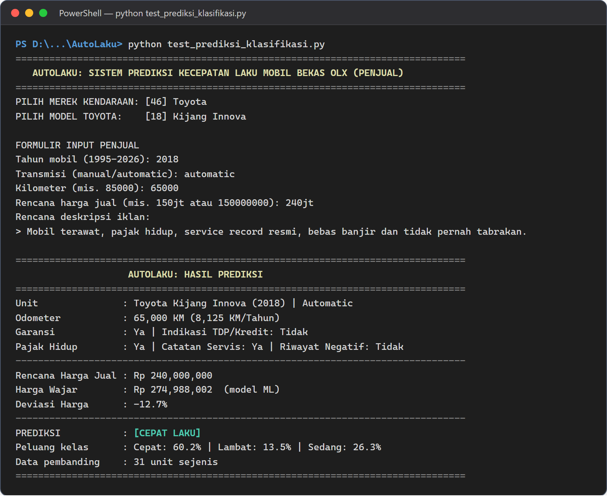
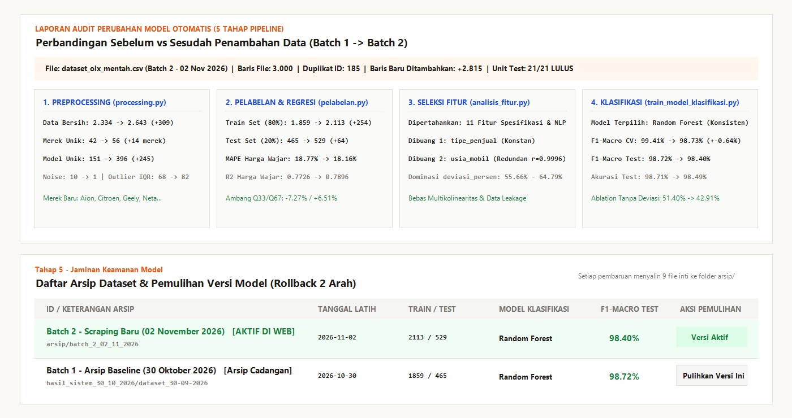
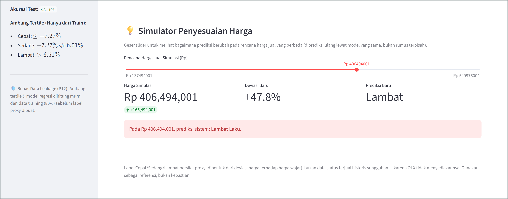
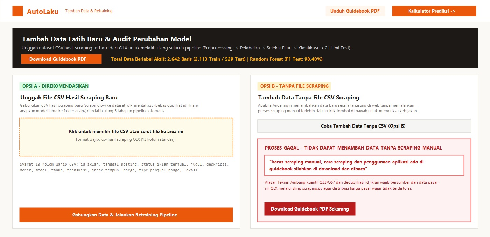
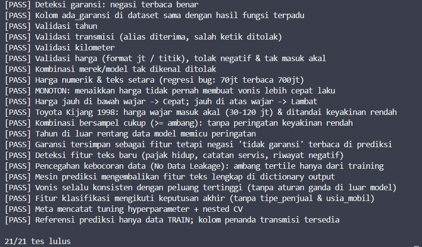

# AutoLaku 🚗

**Sistem Prediksi Kecepatan Laku Mobil Bekas OLX Berdasarkan Harga Wajar, Jarak Tempuh, dan Deskripsi Iklan Menggunakan Metode Klasifikasi**

Tugas Data Mining – Kelas TI24A2 | Program Studi Informatika | Universitas Duta Bangsa Surakarta

[](public/SuratCiptaan_EC002026231775.pdf)
[](https://www.python.org/)
[](https://fastapi.tiangolo.com/)
[](https://scikit-learn.org/)
[-success.svg)](test_sistem.py)

---

## Deskripsi

AutoLaku membantu penjual perorangan mobil bekas di OLX memperkirakan apakah rencana harga jual membuat unit **Cepat**, **Sedang**, atau **Lambat** laku, sebelum iklan dipasang.

Sistem menghitung harga wajar dari data iklan OLX, mengukur seberapa jauh rencana harga dari harga wajar itu, lalu mengklasifikasikan kecepatan laku bersama jarak tempuh dan isi deskripsi iklan.

> **Catatan metodologi:** Label Cepat/Sedang/Lambat adalah *label proxy*. OLX tidak menyediakan data status terjual, sehingga label dibentuk dari deviasi harga iklan terhadap harga wajar. Dasar ilmiahnya ada di bagian [Landasan Ilmiah Pelabelan & Jurnal Referensi](#landasan-ilmiah-pelabelan--jurnal-referensi), keterbatasannya di bagian [Keterbatasan](#keterbatasan).

---

## 📜 Sertifikasi Hak Cipta, Dokumentasi & Publikasi Ilmiah

AutoLaku telah resmi terdaftar dan memperoleh **Surat Pencatatan Ciptaan** dari **Direktorat Jenderal Kekayaan Intelektual (DJKI), Kementerian Hukum Republik Indonesia**, didukung oleh Dokumentasi & Buku Panduan (*Guidebook*) resmi, serta Laporan Penelitian Ilmiah komprehensif.

<div align="center">

| 🏛️ Sertifikat Hak Cipta (DJKI Kemenkumham RI) | 📖 Buku Panduan & Dokumentasi Resmi | 📑 Laporan Lengkap Proyek & Jurnal |
| :---: | :---: | :---: |
| <a href="public/SuratCiptaan_EC002026231775.pdf" target="_blank"></a> | <a href="public/Dokumentasi_AutoLaku.pdf" target="_blank"></a> | <a href="public/Laporan_AutoLaku.pdf" target="_blank"></a> |
| **No. Permohonan:** `EC002026231775`<br>**Jenis Ciptaan:** Program Komputer<br>📅 **Tanggal Terbit:** 16 November 2026<br><a href="public/SuratCiptaan_EC002026231775.pdf">📄 <b>Unduh Surat Ciptaan (PDF)</b></a> | **Dokumentasi & Guidebook v1.0**<br>Petunjuk Scraping, Pipeline, & Retrain<br>🔖 **Format:** PDF Panduan Resmi<br><a href="public/Dokumentasi_AutoLaku.pdf">📄 <b>Unduh Dokumentasi (PDF)</b></a> | **Laporan Ilmiah Data Mining**<br>Sitasi 10 Jurnal (SINTA & Scopus)<br>📊 **Format:** PDF Laporan Akademik<br><a href="public/Laporan_AutoLaku.pdf">📄 <b>Unduh Laporan (PDF)</b></a> |

</div>

---

## 🖥️ Antarmuka & Visualisasi Sistem

Sistem AutoLaku dilengkapi antarmuka web interaktif modern (FastAPI + Jinja2 dan alternatif Streamlit) yang teruji secara komprehensif:

<div align="center">

### 1. Formulir Input Penjual & Hasil Prediksi Likuiditas

| 📝 Formulir Input Penjual & Ekstraksi Fitur Teks | 📊 Kartu Prediksi & Slider Simulasi Harga Dinamis |
| :---: | :---: |
|  |  |
| *Formulir input spesifikasi mobil, odometer, harga rencana, dan deskripsi iklan dengan deteksi NLP otomatis.* | *Kartu hasil estimasi harga wajar, persentase deviasi, label likuiditas, dan slider simulasi dinamis.* |

<br>

### 2. Modul Tambah Data Latih Baru, Audit Perubahan, & Pengujian Sistem

| 🔄 Manajemen Tambah Data Latih Baru | 📈 Dashboard Audit Evaluasi Model (Sebelum vs Sesudah) |
| :---: | :---: |
|  |  |
| *Menu pengunggahan CSV batch baru, deduplikasi ID iklan otomatis, pengarsipan otomatis, dan auto-rollback.* | *Audit komparatif 5 tahap pipeline (pembersihan, pelabelan, fitur, model, tes) dengan opsi rollback versi.* |

<br>

| 🧪 Verifikasi & Pengujian Sistem Otomatis (21/21 Unit Test PASS) |
| :---: |
|  |
| *Pengujian otomatis 21 skenario fungsional, integritas data, dan pencegahan data leakage lulus 100%.* |

</div>

---

## Alur Pipeline

```
scraping.py                → dataset_olx_mentah.csv
processing.py              → dataset_olx_bersih.csv     (normalisasi slang + 5 fitur NLP)
pelabelan.py               → dataset_olx_berlabel.csv   (split 80:20 di awal + regresi + label tertile)
analisis_fitur.py          → fitur_final.json           (feature selection pada data train)
train_model_klasifikasi.py → model_*.pkl + autolaku_meta.json
test_sistem.py             → 21 tes otomatis
tambah_data.py             → gabung CSV baru + arsip + retrain pipeline + riwayat_data.json
server.py / app.py         → antarmuka web utama (FastAPI) & alternatif (Streamlit)
```

## Struktur File

| File / Folder | Peran |
|---|---|
| `public/` | Berkas publik: Sertifikat Hak Cipta, Laporan Ilmiah, Buku Panduan (PDF) & aset pratinjau gambar |
| `scraping.py` | Scraping iklan mobil bekas dari OLX menggunakan Playwright |
| `kamus_slang_otomotif.py` | Kamus normalisasi istilah & singkatan otomotif Indonesia |
| `processing.py` | Pembersihan data mentah, ekstraksi 5 fitur NLP, dan imputasi median bertingkat |
| `pelabelan.py` | Split train/test 80:20, seleksi model regresi harga wajar, dan pelabelan kuantil tertile |
| `analisis_fitur.py` | Seleksi fitur statistik (Kruskal-Wallis, Cramer's V, MI, RF Importance) → `fitur_final.json` |
| `model_khusus.py` | Pembungkus Naive Bayes (`CategoricalNBWrapper`) dengan diskretisasi kuartil |
| `train_model_klasifikasi.py` | Perbandingan 6 kandidat model, nested CV tuning, uji ablation, dan evaluasi akhir |
| `tambah_data.py` | Modul penambahan data latih baru, deduplikasi `id_iklan`, pengarsipan otomatis (`arsip/`), eksekusi ulang 5 tahap pipeline, *auto-rollback*, pencatatan riwayat perubahan (`riwayat_data.json`), dan penyedia Guidebook PDF |
| `mesin_prediksi.py` | Engine inferensi tunggal (dipakai bersama oleh `server.py`, `app.py`, `test_prediksi_klasifikasi.py`, dan `test_sistem.py`) |
| `test_prediksi_klasifikasi.py` | Antarmuka interaktif berbasis terminal (CLI) untuk penjual |
| `test_sistem.py` | 21 pengujian otomatis untuk memverifikasi integritas data, model, dan pencegahan *data leakage* |
| `server.py` | Server web utama berbasis FastAPI + Jinja2: Landing Page (`/`), Kalkulator & Simulator (`/prediksi`), Menu Tambah Data Baru & Audit Perubahan (`/tambah-data`), serta Unduh Guidebook (`/download/guidebook`) |
| `templates/` | Template antarmuka web: `landing.html`, `index.html`, dan `tambah_data.html` |
| `static/` | Aset statis web: foto merek mobil (`static/images/cars/`) dan Guidebook PDF (`static/guidebook_autolaku.pdf`) |
| `app.py` | Antarmuka alternatif berbasis Streamlit |

File yang dihasilkan otomatis: `dataset_olx_bersih.csv`, `dataset_olx_berlabel.csv`, `fitur_final.json`, `model_regresi_harga.pkl`, `model_klasifikasi_likuiditas.pkl`, `autolaku_meta.json`, `keputusan_fitur.csv`, `laporan_preprocessing.txt`, `riwayat_data.json`, `static/guidebook_autolaku.pdf`.

---

## Cara Menjalankan

> **Catatan Windows:** Jika perintah `python` mengarah ke Microsoft Store Alias di komputer Anda, gunakan perintah `py` sebagai pengganti `python`.

```bash
pip install pandas numpy scikit-learn matplotlib streamlit fastapi uvicorn jinja2

py processing.py
py pelabelan.py
py analisis_fitur.py
py train_model_klasifikasi.py     # beberapa menit (nested CV)
py test_sistem.py                 # target: 21/21 lulus

py server.py                      # antarmuka web utama (buka http://localhost:8000)
streamlit run app.py              # antarmuka Streamlit alternatif
py test_prediksi_klasifikasi.py   # antarmuka terminal
```

> Hapus `.pkl` dan `autolaku_meta.json` lama sebelum menjalankan ulang dari awal secara manual. Jangan lewati `analisis_fitur.py`, karena `train_model_klasifikasi.py` membaca `fitur_final.json`.
> Untuk menambahkan batch hasil scraping baru secara aman beserta arsip dan perbandingannya, gunakan menu web `/tambah-data` atau skrip `py tambah_data.py`.

---

## Menambah Data Latih Baru & Audit Perubahan Model

Fitur ini dirancang khusus untuk menjawab pertanyaan evaluasi **"Bagaimana jika ada data baru?"**. Karena algoritma pada scikit-learn menggunakan pendekatan *Batch Learning*, setiap penambahan data baru diproses dengan menggabungkan iklan baru yang bebas duplikat ke dataset mentah, mengarsipkan versi lama, melatih ulang seluruh pipeline dari awal hingga pengujian 21 unit test, lalu menyajikan laporan perbandingan **Sebelum vs Sesudah** secara transparan.

### 1. Melalui Menu Website (`http://localhost:8000/tambah-data`)
Jalankan `py server.py` lalu buka menu **Tambah Data & Riwayat** (`/tambah-data`). Halaman ini menyediakan:

- **Unduh Guidebook PDF (`/download/guidebook`):**
  Tombol untuk mengunduh buku panduan resmi (PDF) yang berisi langkah-langkah melakukan scraping manual dari OLX (`scraping.py`), syarat 13 kolom wajib CSV, serta cara penggunaan aplikasi.
- **Opsi A – Unggah CSV Hasil Scraping Baru & Retraining (`POST /api/tambah-data`):**
  1. Memvalidasi struktur 13 kolom wajib (`id_iklan`, `tanggal_posting`, `status_iklan_terjual`, `judul`, `deskripsi`, `merek`, `model`, `tahun`, `transmisi`, `jarak_tempuh`, `harga`, `tipe_penjual_badge`, `lokasi`) serta menampilkan pratinjau jumlah baris di browser.
  2. Membuang iklan duplikat berdasarkan `id_iklan` sehingga hanya iklan yang benar-benar baru yang ditambahkan.
  3. Menyimpan cadangan (*backup*) 9 file data dan model aktif ke folder `arsip/<timestamp>/`.
  4. Menjalankan 5 tahap pipeline secara berurutan: `processing.py` → `pelabelan.py` → `analisis_fitur.py` → `train_model_klasifikasi.py` → `test_sistem.py`.
  5. Melakukan **Auto-Rollback** (memulihkan seluruh file dari arsip) apabila ada tahapan yang gagal.
  6. Memuat ulang (*hot-reload*) model di memori server via `segarkan_sistem()` agar kalkulator `/prediksi` langsung memakai model terbaru tanpa perlu me-restart server.
- **Opsi B – Percobaan Tambah Data Tanpa CSV (`POST /api/opsi-tanpa-csv`):**
  Sesuai aturan integritas data sistem (karena ambang kuantil $Q_{33}$/$Q_{67}$ dan deduplikasi wajib berasal dari data iklan pasar riil OLX), jika pengguna mencoba memilih Opsi B (menambah data tanpa CSV hasil scraping), sistem menolak proses dan menampilkan notifikasi peringatan:
  > `"harus scraping manual, cara scraping dan penggunaan aplikasi ada di guidebook silahkan di download dan dibaca"`
  dilengkapi tombol unduh langsung ke `/download/guidebook`.
- **Dashboard Perbandingan Perubahan Model (Sebelum vs Sesudah):**
  Menampilkan rincian pergeseran metrik dari data latihan lama ke data baru pada 5 tahapan:
  1. **Tahap 1 (`processing.py`):** Baris mentah, duplikat dilewati, data bersih valid, baris noise, outlier harga IQR, imputasi KM, transmisi asumsi, jumlah merek & model unik, harga median pasar, serta **daftar merek baru yang bertambah**.
  2. **Tahap 2 (`pelabelan.py`):** Ukuran Train Set (80%) & Test Set (20%), algoritma regresi harga wajar terpilih, MAPE, MAE, $R^2$, pergeseran ambang kuantil $Q_{33}$ dan $Q_{67}$, serta distribusi kelas *Cepat / Sedang / Lambat*.
  3. **Tahap 3 (`analisis_fitur.py`):** Daftar 11 fitur yang dipertahankan vs 2 fitur yang dibuang (`tipe_penjual`, `usia_mobil`) beserta alasan statistiknya.
  4. **Tahap 4 (`train_model_klasifikasi.py`):** Model klasifikasi terpilih, F1-Macro CV 5-Fold ($\pm$ std), F1-Macro Test, Akurasi Test, RMSE Ordinal, Keyakinan Puncak, pembuktian **Uji Ablation** (*Dengan* vs *Tanpa* `deviasi_persen`), serta tabel perbandingan 6 kandidat algoritma.
  5. **Tahap 5 (`test_sistem.py` & Rollback `POST /api/rollback`):** Status kelulusan 21 tes otomatis serta tabel daftar seluruh versi model (**Batch 2 Aktif**, **Batch 1 Baseline**, dan backup otomatis) dengan tombol **Pulihkan Versi Ini (Rollback)**.

### 2. Melalui Terminal (`tambah_data.py`)

```bash
py tambah_data.py hasil_scraping_baru.csv
py tambah_data.py hasil_scraping_baru.csv --tanpa-latih   # hanya gabung data ke CSV mentah
py tambah_data.py hasil_scraping_baru.csv --paksa         # tetap latih ulang walau 0 baris baru / tes gagal
```

### 3. Melalui Aplikasi Streamlit (`app.py`)
Buka sidebar `streamlit run app.py`, pilih **Admin: Tambah Data Latih & Retraining**, unggah CSV pada Opsi A, coba Opsi B, atau unduh Guidebook PDF.

---

## Hasil per Batch Data

Pipeline dijalankan pada dua batch hasil scraping. **Batch 1** adalah data awal (3.000 baris mentah). **Batch 2** adalah hasil scraping ulang. Angka di bawah dihitung dari `dataset_olx_bersih.csv` dan `dataset_olx_berlabel.csv` masing-masing batch, pada data test.

### Ukuran data dan pelabelan

| Aspek | Batch 1 | Batch 2 |
|---|---|---|
| Data mentah | 3.000 baris | 3.000 baris |
| Data bersih | 2.334 | 2.643 |
| Noise km ditandai | 10 | 1 |
| Data berlabel | 2.324 | 2.642 |
| Train / Test | 1.859 / 465 | 2.113 / 529 |
| Merek unik | 42 | 56 |
| Model unik | 151 | 396 |
| Baris bermodel "Lainnya" | 15,2% | 0% |
| Kombinasi dengan sampel < 15 | 61,6% | 66,9% |
| Transmisi hanya asumsi | 31,1% | 35,4% |
| Harga median | Rp 220 jt | Rp 210 jt |
| Ambang Q33 / Q67 (dari train) | −6,96% / +7,30% | −7,27% / +6,51% |

Ambang tertile hampir sama di kedua batch (sekitar ±7%), jadi batas Cepat/Sedang/Lambat relatif stabil terhadap penambahan data.

### Distribusi label proxy (%)

| Data | Cepat | Sedang | Lambat |
|---|---|---|---|
| Batch 1 – train | 32,8 | 34,2 | 33,0 |
| Batch 1 – test | 34,0 | 34,2 | 31,8 |
| Batch 2 – train | 32,7 | 34,3 | 33,0 |
| Batch 2 – test | 28,9 | 33,8 | 37,2 |

Distribusi test tidak sama dengan 33/33/33 karena ambang dihitung hanya dari train. Pada batch 2, test condong ke Lambat (37,2%). Ini yang terjadi jika ambang tidak ikut dilihat oleh data test.

### Model harga wajar (data test)

| Metrik | Batch 1 | Batch 2 |
|---|---|---|
| MAPE (model saja) | 19,80% | 18,48% |
| R² (model saja) | 0,7420 | 0,8462 |
| MAPE (model + fallback usia) | 18,43% | 18,16% |
| R² (model + fallback usia) | 0,7587 | 0,7896 |
| MAE (model + fallback usia) | Rp 76,5 jt | Rp 66,7 jt |
| Harga wajar dari model ML | 35,8% | 36,6% |
| Harga wajar dari fallback regresi usia (merek) | 8,2% | 17,9% |

Data yang lebih banyak memperbaiki model harga wajar. Pada batch 2, fallback usia menurunkan MAPE sedikit tetapi **menurunkan R²** (0,846 menjadi 0,790), sehingga ambang fallback perlu dievaluasi ulang.

### Hasil klasifikasi

| Metrik | Batch 1 | Batch 2 |
|---|---|---|
| Model terpilih | Random Forest | Random Forest |
| F1-macro CV (5-fold) | 99,41% ± 0,46% | 98,73% ± 0,64% |
| F1-macro test | 98,72% | 98,40% |
| Akurasi test | 98,71% | 98,49% |
| RMSE Ordinal test | 0,1136 | 0,1230 |
| Akurasi tanpa `deviasi_persen` (ablation) | 51,40% (F1 50,76%) | 42,91% (F1 41,87%) |

Kedua batch secara konsisten memilih **Random Forest** sebagai model klasifikasi terbaik dengan F1-macro di atas 98,4% pada data uji.

### Tes otomatis

| | Batch 1 | Batch 2 |
|---|---|---|
| Hasil | 21/21 lulus | 21/21 lulus |

Seluruh 21 tes integritas sistem pada `test_sistem.py` lulus 100% pada kedua batch setelah pengujian mengambil kasus secara dinamis dari dataset aktif.

### Temuan pada data batch 2 yang perlu ditangani

1. **Model terlalu rinci.** Kolom `model` kini terisi penuh (nama seperti `218I`, `318I`, `A140`, `A200`), sehingga 285 dari 396 model hanya punya kurang dari 5 baris. Akibatnya sampel per kombinasi menipis dan lebih banyak harga wajar jatuh ke fallback tingkat merek.
2. **Kendaraan non-mobil ikut terscraping.** Ada 30 baris (1,1%) motor, truk, dan van: Yamaha, Kawasaki, KTM, Ducati, Harley Davidson, Piaggio, Aprilia, Hino, Maxus, dan "Truk". Perlu difilter berdasarkan daftar merek mobil.
3. **Standardisasi merek belum tuntas.** `Dfsk` dan `Dfsk (Dongfeng Sokon)` masih terpisah.
4. **Batch 2 bukan scraping ulang yang lengkap.** Hanya 185 `id_iklan` yang sama dengan batch 1. Karena itu iklan yang "hilang" di batch 2 tidak bisa dianggap sudah terjual.

---

## Data dan Preprocessing

- **Sumber:** scraping mandiri dari [OLX Indonesia](https://www.olx.co.id/mobil-bekas_c198)
- **Alur batch 1 (30 Okt 2026):** 3.000 mentah → 2.334 bersih → 2.324 berlabel (10 baris noise km dikeluarkan di `pelabelan.py`) → 1.859 train / 465 test (80/20, stratifikasi per kuartil harga)
- **Alur batch 2 (02 Nov 2026, aktif saat ini):** 3.000 mentah → 2.643 bersih → 2.642 berlabel (1 baris noise km dikeluarkan di `pelabelan.py`) → 2.113 train / 529 test (80/20, stratifikasi per kuartil harga)

| Tahap | Keterangan |
|---|---|
| Ekstraksi tahun, transmisi, model dari judul | Kolom mentah tahun/transmisi kosong efektif |
| Standardisasi merek | Penulisan tidak konsisten diseragamkan |
| Filter harga (boneka, di luar Rp 25 jt–3 miliar) dan tahun (1995–2026) | Data tidak wajar dibuang |
| Deteksi noise berbasis aturan domain (km) | Ditandai, lalu dikeluarkan saat pelabelan |
| Deteksi outlier IQR pada log-harga per merek | Hanya ditandai, tidak dibuang (mobil mewah bisa valid) |
| Fitur teks dengan penanganan negasi | `ada_garansi`, `riwayat_negatif`, `catatan_servis`, `pajak_hidup` |
| Hapus duplikat (batch 1: 304 baris, batch 2: 185 duplikat lintas batch) | Sebagian besar iklan yang dipasang ulang (66% judul identik, 83% lokasi sama) |
| Penanda transmisi asumsi | Iklan tanpa info transmisi diisi `automatic` dan ditandai `transmisi_dari_teks=0` |

---

## Feature Selection

Dilakukan di `analisis_fitur.py`, hanya pada data train. Hasilnya di `fitur_final.json` dan dibaca otomatis oleh training.

- **Dibuang:** `tipe_penjual` (konstan, seluruhnya penjual individu) dan `usia_mobil` (redundan dengan `tahun`, r = −1,00 / |r| ≥ 0,9995)
- **Dipakai (11 fitur):** `merek`, `model`, `transmisi`, `ada_garansi`, `riwayat_negatif`, `catatan_servis`, `pajak_hidup`, `tahun`, `jarak_tempuh`, `km_per_tahun`, `deviasi_persen`
- **Temuan:** `deviasi_persen` sangat dominan (importance Random Forest 64,79% pada batch 1 dan 55,66% pada batch 2). Fitur lain berperan sebagai penjelas pendamping.

---

## Model

### Harga wajar

Target regresi adalah $\log(\text{harga})$, dipilih otomatis berdasarkan MAPE terendah pada 5-fold CV data train dari 4 kandidat (`Linear Regression`, `Ridge (alpha=1.0)`, `Random Forest`, `Gradient Boosting`). Pada Batch 1 terpilih **Ridge (alpha=1.0)** (MAPE OOF 18,77%, $R^2$ 0,7726), sedangkan pada Batch 2 terpilih **Linear Regression** (MAPE OOF 20,10% dengan fallback / 19,50% model saja, $R^2$ 0,7735). Kombinasi dengan sampel kurang dari 15 memakai fallback regresi usia per model atau per merek.

### Klasifikasi (perbandingan 6 kandidat pada Skenario 2)

| Model | F1 CV (Batch 1) | F1 CV (Batch 2) | Keyakinan (Batch 2) | Keputusan |
|---|---|---|---|---|
| Logistic Regression | 93,84% ± 1,54% | 93,61% ± 1,22% | 84,56% | OK |
| KNN (K=5) | 61,59% ± 1,15% | 59,14% ± 3,50% | 68,89% | Ditolak: overfitting & langgar monoton |
| Naive Bayes (Bernoulli, diskretisasi) | 87,51% ± 0,78% | 88,34% ± 1,22% | 92,26% | OK |
| Decision Tree | 99,79% ± 0,20% | 99,86% ± 0,12% | 100,00% | Ditolak: overconfident (100%) |
| **Random Forest** | **99,41% ± 0,46%** | **98,73% ± 0,64%** | **60,66%** | **Terpilih (Batch 1 & Batch 2)** |
| Gradient Boosting | 99,79% ± 0,20% | 99,86% ± 0,12% | 100,00% | Ditolak: overconfident (100%) |

Kriteria pilih: F1-macro CV tertinggi di antara model yang monoton terhadap harga, tidak overconfident (keyakinan puncak ≤ 97%), dan tanpa overfitting berlebih. **Tuning:** RandomizedSearchCV dengan nested CV memberi F1 99,57% ± 0,36% (Batch 1) dan 99,76% ± 0,15% (Batch 2), namun parameter default Random Forest dipertahankan karena selisih tidak melebihi 1 std atau kandidat hasil tuning melanggar batas overconfidence.

**Label proxy:** Cepat jika deviasi ≤ Q33, Sedang jika di antara Q33 dan Q67, Lambat jika di atas Q67. Ambang hanya dari data train.

**Uji ablation:** tanpa `deviasi_persen`, akurasi pada test set turun dari 98,71% ke 51,40% (Batch 1) dan dari 98,49% ke 42,91% (Batch 2), mendekati tebakan acak. Classifier mempelajari aturan pemisahan kuantil deviasi harga bersama fitur spesifikasi dan teks iklan.

---

## Landasan Ilmiah Pelabelan & Jurnal Referensi

Label dibuat otomatis lewat kode, jadi setiap langkahnya memiliki rujukan akademik yang kuat.

| Langkah di `pelabelan.py` | Rujukan Utama | Alasan Jadi Patokan |
|---|---|---|
| Deviasi harga mewakili kecepatan laku | **Granát & Vékás (2025)** | Pada marketplace mobil bekas online, rasio harga listing terhadap harga prediksi ML adalah prediktor dominan durasi iklan (*time-on-market*). |
| Deviasi harga mewakili kecepatan laku | **Born dkk. (2018)** | Variabel DOP (*Degree of Overpricing*) terbukti empiris: makin tinggi deviasi harga, makin lama unit mobil tertahan di pasar. |
| Harga wajar dari regresi karakteristik | **Rosen (1974)** | Fondasi teori harga hedonik: nilai wajar produk adalah fungsi dari karakteristik teknis dan fiturnya. |
| Pengelompokan aturan lemah (proxy) | **Ratner dkk. (2017)** | Prinsip *weak supervision*: pelabelan terstruktur berbasis aturan domain yang konsisten. |
| Hubungan harga penawaran vs likuiditas | **Anglin dkk. (2003)** | Membuktikan secara matematis *trade-off* antara harga jual penawaran dan waktu pemasaran (*time-on-the-market*). |

### Daftar Pustaka Lengkap (10 Jurnal Acuan Laporan - Format APA 7th)

1. **Ahmed, A. S., Alsaade, B. M., & Al-Samarraie, S. H. (2021).** Optimizing used car price prediction using ensemble learning methods. *Applied Soft Computing*, 113, Article 107936. https://doi.org/10.1016/j.asoc.2021.107936
2. **Arif, M., & Faisal, M. (2023).** Penerapan model regresi linear untuk estimasi mobil bekas menggunakan bahasa Python. *Euler: Jurnal Ilmiah Matematika, Sains dan Teknologi*, 11(2), 177–184. https://doi.org/10.37905/euler.v11i2.20698
3. **Bergmann, S., & Feuerriegel, S. (2024).** Machine learning for predicting used car resale prices using granular vehicle equipment information. *Expert Systems with Applications*, 263, Article 125640. https://doi.org/10.1016/j.eswa.2024.125640
4. **Bukvić, L., Pašagić Škrinjar, J., Fratrović, T., & Abramović, B. (2022).** Price prediction and classification of used-vehicles using supervised machine learning. *Sustainability*, 14(24), Article 17034. https://doi.org/10.3390/su142417034
5. **Cui, B., Ye, Z., Zhao, H., Renqing, Z., Meng, L., & Yang, Y. (2022).** Used car price prediction based on the iterative framework of XGBoost+LightGBM. *Electronics*, 11(18), Article 2932. https://doi.org/10.3390/electronics11182932
6. **Granát, M. P., & Vékás, P. (2025).** Estimating liquidity in online marketplaces via machine learning and survival analysis. *Manuscript*. https://real.mtak.hu/247298/1/epj_survival.pdf
7. **Hasibuan, E., & Karim, A. (2022).** Implementasi machine learning untuk prediksi harga mobil bekas dengan algoritma regresi linear berbasis web. *Jurnal Ilmiah Komputasi*, 21(4), 513–520. https://doi.org/10.32409/jikstik.21.4.3327
8. **Kriswantara, B., Kurniawati, K., & Pardede, H. F. (2021).** Prediksi harga mobil bekas dengan machine learning. *Syntax Literate: Jurnal Ilmiah Indonesia*, 6(5), 2189–2199. https://doi.org/10.36418/syntax-literate.v6i5.2716
9. **Kriswantara, B., & Sadikin, R. (2022).** Used car price prediction with Random Forest regressor model. *Journal of Information Systems, Informatics and Computing (JISICOM)*, 6(1), 162–171. https://doi.org/10.52362/jisicom.v6i1.752
10. **Nguyen, M., & Ryu, K. (2022).** Deep learning-based used car price prediction model. *IEEE Access*, 10, 34510–34518. https://doi.org/10.1109/ACCESS.2022.3175378

---

## Evaluasi Model

- Split train/test dilakukan **sebelum** label dibuat dan sebelum ambang tertile dihitung
- Preprocessing (scaling, one-hot) berada di dalam pipeline CV, di-*fit* hanya dari data train tiap fold
- Test set dibuka sekali, hanya untuk evaluasi akhir
- Selisih F1 train dan validasi dilaporkan untuk tiap kandidat
- Referensi prediksi di aplikasi hanya data train
- Output metrik klasifikasi tampil dalam persen. RMSE ordinal tetap angka biasa (skala 0–2)

---

## Keterbatasan

1. **Label proxy.** OLX tidak menyediakan status terjual. Rujukan di atas mendukung arah hubungannya, tetapi label belum divalidasi terhadap penjualan nyata.
2. **Akurasi tinggi sebagian sirkular.** Tanpa `deviasi_persen`, akurasi hanya 51,40% (Batch 1) dan 42,91% (Batch 2).
3. **Transmisi 31–35% adalah asumsi** (iklan tidak menyebut transmisi, diisi `automatic`).
4. **Data jarang per model.** Sekitar 62–67% kombinasi merek+model+usia punya sampel kurang dari 15, sehingga banyak prediksi berkeyakinan rendah.
5. **Data snapshot.** Bukan real-time. Harga pasar dapat berubah.
6. **Validasi umur iklan tidak reliabel.** `tanggal_posting` kemungkinan tanggal dibuat, bukan diperbarui.
7. **Fokus penjual saja.** Tidak ada mode pembeli.

### Rencana validasi label

Cara terbaik memvalidasi label adalah memantau iklan yang sama dari waktu ke waktu dan mencatat kapan iklan menghilang, seperti pada Granát & Vékás (2025) dan Born dkk. (2018). Scraping ulang daftar iklan tidak cukup, karena hanya 185 iklan yang sama antara batch 1 dan batch 2. Yang diperlukan adalah mengunjungi ulang setiap `id_iklan` dan mencatat apakah halamannya masih aktif.

---

## Tim Pengembang & Lisensi

Proyek akademik mata kuliah Data Mining (Kelas TI24A2), Program Studi Informatika, Fakultas Ilmu Komputer, Universitas Duta Bangsa Surakarta.

**Dosen Pengampu:** Sunneng Sadino Berutu, M.Kom., Ph.D.

**Disusun Oleh (Kelompok AutoLaku):**
1. Nugroho Saputra Jati (240103073)
2. Afrilza Maulid Ardian (240103021)
3. Bagus Adji Rohman (240103043)
4. Radika Divia Putri (240103030)
5. Geraldi Eka Kurniawan (240103038)
6. Asy Syiffa Yofika Ailsa (240103040)
7. Aldy Arya Kusuma (240103042)

Data bersumber dari scraping publik platform OLX Indonesia untuk kepentingan penelitian dan pembelajaran ilmiah.
